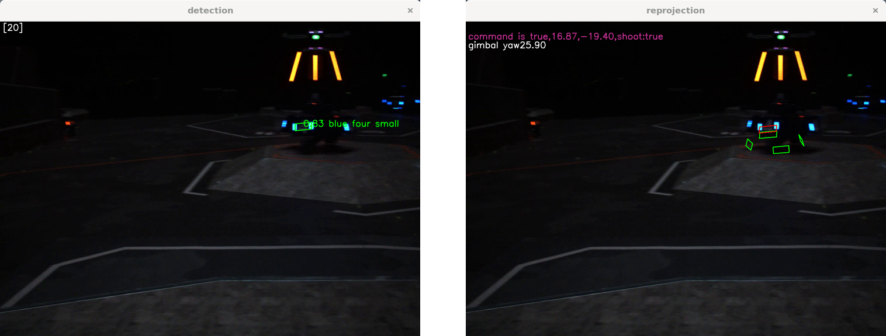

# Task 1
这个任务请在面试的时候展示或说明。

> [!example] 基础任务
> **你需要：**
> &emsp;&emsp;从 Github 上将代码项目 `sp_vision_25` 克隆到你的虚拟机上，并将其编译，最后使用 video 文件夹下的**视频和文本文件**运行 `auto_aim_test`。
> &emsp;&emsp;如果运行成功，程序应该会出现两个窗口，其图像大概如下：
>
>
> 

> [!example] 选做任务
> &emsp;&emsp;视频中，`detection` 窗口的绿色框表示**识别**到的装甲板，`reprojection` 窗口的绿色框表示经过 PnP 解算装甲板三维坐标后，再根据三维坐标**重新投影**出来的装甲板位置。
> &emsp;&emsp;如果使用项目自带的参数运行，可以看到 `reprojection` 窗口中的绿色框与装甲板根本不重合，而且在上下浮动。这是因为这个视频是我们机器人拍摄的，但是使用的不是我们的参数。
> &emsp;&emsp;video/demo.yaml 中填写的是我们机器人使用的一些参数，将其稍作修改并用于运行 `auto_aim_test`，即可使得 `reprojection` 窗口中的绿色框与装甲板大致重合。
> &emsp;&emsp;不过其实，导致绿框严重偏移只是一行参数的问题。
> 
> **你需要：**
> &emsp;&emsp;说明一下是**哪个参数**导致的绿框严重偏移？并简单说明一下原因（~~当然如果你说试出来的也不是不行~~）