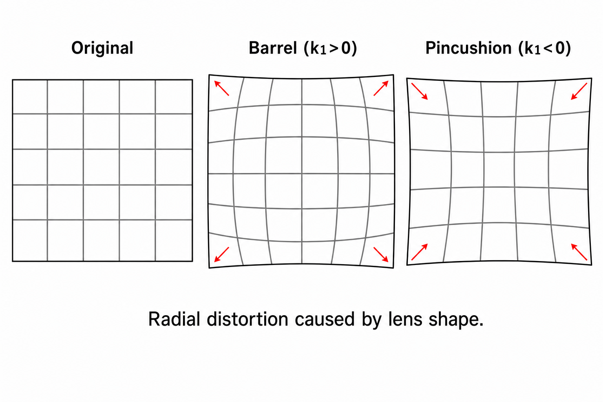
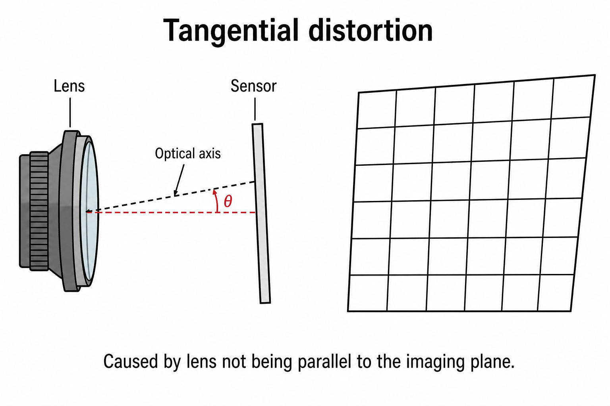
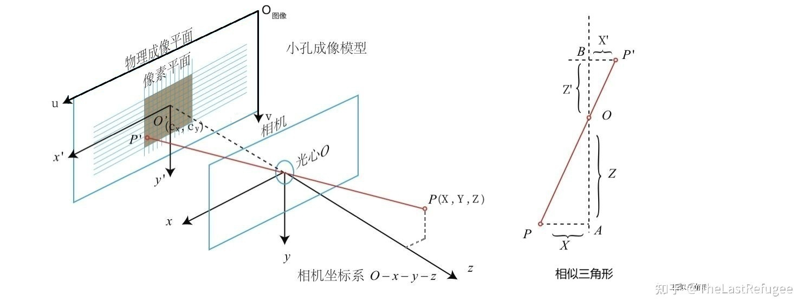
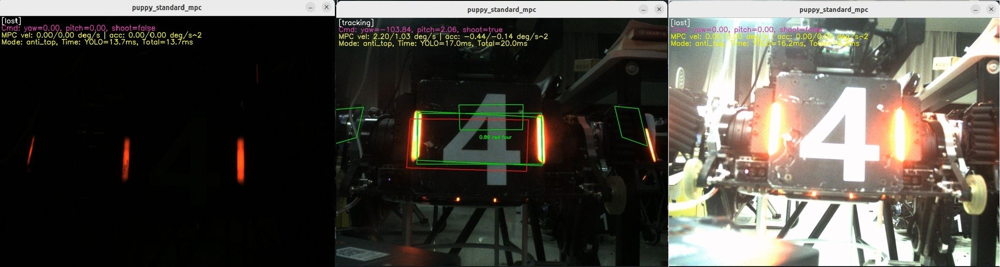
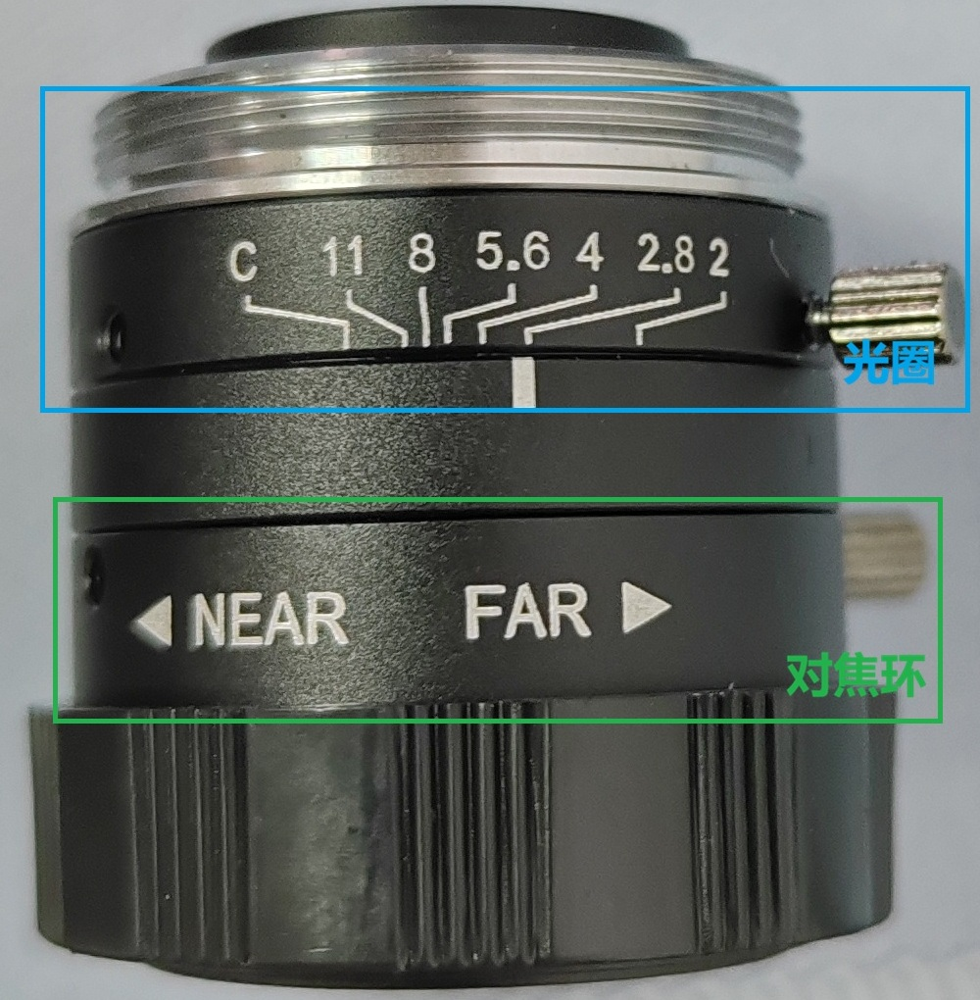
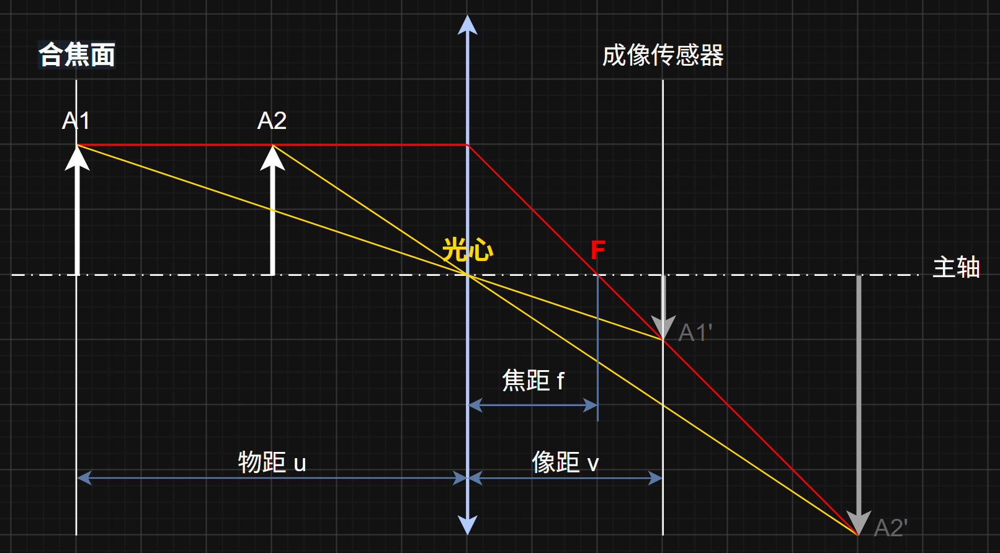
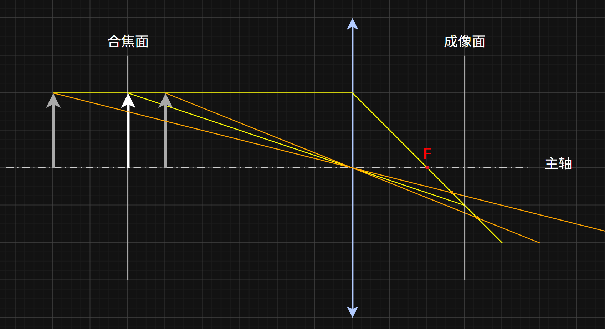
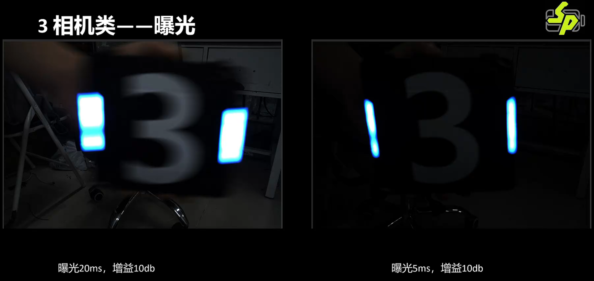
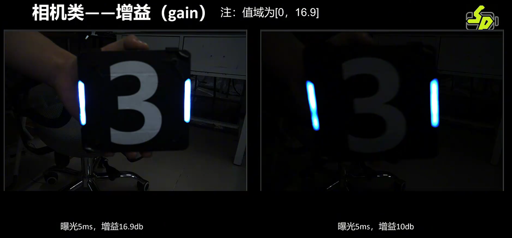

# Lecture 2：Hello Camera

[TOC]

---
## part1: 相机标定原因
实际的相机并不能理想地获取图像，我们需要使用标定来减少一些误差。
### 一、相机畸变
由于凸透镜本身的形式和镜头制造工艺的问题，镜头的成像会出现变形，我们称为**畸变(distortion)**，主要有以下两种：
- **径向畸变**：由于透镜形状不规则导致。

经过一些数学推导，径向畸变造成的影响可以表示为：
$$
x_{distorted}=x(1+k_1r^2+k_2r^4+k_3r^6) \\[10pt] 
y_{distorted}=y(1+k_1r^2+k_2r^4+k_3r^6)
$$

由于 $r$ 是一个微小值，我们可以看出 $k_1$ 对坐标的影响 $> k_2$ 对坐标的影响 $> k_3$ 对坐标的影响。对于我们使用的一般的工业相机，**只需计算和使用 $k_1,k_2$ 即可**，$k_3$ 仅用于鱼眼镜头或者超广角镜头，强行计算反而会导致结果不好。

- **切向畸变**：成像面未与透镜严格平行导致。

经过一些数学推导，切向畸变造成的影响可以表示为：
$$
x_{distorted}=x+[2p_1xy+p_2(r^2+2x^2)] \\[10pt] 
y_{distorted}=y+[p_1(r^2+2y^2)+2p_2xy]
$$

我们会将这些数据组织成一个数组并记录，我们叫它**相机畸变参数**：
$$
\text{Distortion coefficients}=(k_1, k_2, p_1, p_2, k_3)
$$

### 二、相机内参
&emsp;&emsp;除了解决畸变，相机标定还可以给我们提供一些相机属性相关的参数，**这些参数可以帮助我们找到图像中物体在世界中的坐标**。
#### (0) 针孔相机模型
&emsp;&emsp;在计算机视觉中，相机通常用**针孔相机模型**描述。因为物体成的像一定会在通过光心的直线上，所以我们可以只看通过光心的光线来确定像的位置。
&emsp;&emsp;大家可以参考一下下面这张图：设相机坐标系下一点为 $P=(X,Y,Z)$，其中 $Z$ 是沿光轴方向的深度，则该点投影到图像像素坐标 $(u,v)$ 的关系为：
$$ u = f_x \frac{X}{Z} + c_x \\[10pt]
v = f_y \frac{Y}{Z} + c_y
$$

> [!note] 推导 | 世界坐标转像素坐标
> &emsp;&emsp;想要知道相机坐标系下的一个点在画面中的像素坐标，我们需要先知道它在成像平面上的坐标，也就是需要先算出图中的 $X'$。
> &emsp;&emsp;根据相似三角形的关系，$X' = Z'\frac{X}{Z}$
> &emsp;&emsp;接下来我们需要将物理距离转化成像素个数，那么我需要知道**成像平面上的单位长度内的像素个数**，记为 $a$。
> &emsp;&emsp;则 $u$ 方向的以像素为单位的偏离中心距离 $$\Delta u = \frac{X'}{a} = \frac{Z'}{a}\frac{X}{Z}$$
> &emsp;&emsp;记 $f_x = \frac{Z'}{a}$，于是得到 $\Delta u = f_x\frac{X}{Z}$
> &emsp;&emsp;由于**像素坐标的原点是图像的一个角落**，所以这个投影的坐标还需要加上中心坐标，于是得到$$ u = f_x \frac{X}{Z} + c_x$$，而 $v$ 方向同理，得到 $v = f_y \frac{Y}{Z} + c_y$。

#### (1) 光学中心 $(c_x,c_y)$
&emsp;&emsp;这是光心在图像中的像素坐标，也就是图中的 $O'$。
&emsp;&emsp;理论上，主光轴（也就是z轴）应该穿过图像的正中心。但是由于镜头装配的一些微小误差，主光轴在传感器上的实际落点会偏移。我们需要记录相机传感器实际对应到主光轴的像素以用于一些校准，这个坐标被记为 $c_x$ 和 $c_y$ 。

#### (2) 像素焦距 $(f_x,f_y)$
&emsp;&emsp;$f_x,f_y$ 称为**像素焦距**，它们表示平面坐标转换为像素坐标时，在 $x$、$y$ 方向上的缩放系数。

由于计算需要，这几个参数会以矩阵的形式存储，形成**相机内参矩阵**：
$$
\text{camera matrix} = \begin{bmatrix} f_x&0&c_x \\ 0&f_y&c_y \\ 0&0&1 \end{bmatrix}
$$

---
## part2: 相机标定程序展示
相机标定就是为了算出上面这几个重要参数的，接下来我展示一下我们运行相机标定程序的过程。
### 一、程序运行展示
为了获取相机的畸变参数和内参矩阵，我们需要进行相机标定。我们调用 OpenCV 写好的功能函数来处理图像和计算参数。
> [!example] 展示环节 | 相机标定操作
> 接下来我会使用一些已经拍好的照片来运行一下我们自瞄项目中的相机标定程序`calibrate_camera_chessboard.cpp`，大家需要注意看看：
> - 拍摄的图像及识别结果
> - 程序的输出结果
>
> 除此之外，相机拍摄的照片其实还可以用于帮我们确定**云台到相机的旋转矩阵和平移向量**，这可以用于坐标变换。接下来我会运行手眼标定程序 `calibrate_chessboard_handeye.cpp`。

### 二、检查标定结果
由于图像不好或者数据问题，程序计算出的标定结果不一定是准确的，我们还需要检查一些内容，如果结果有问题则需要重新走一遍标定的流程：
#### (1) 畸变参数和相机内参检查
- **畸变参数中的 $p_1，p_2$ 应当很小**。因为成熟的相机工艺已经可以将这个值变得很小了。如果这个值超过了 $10^{-3}$，则标定结果不可靠。
- **相机内参的 $(f_x,f_y)$ 的差别应当不大**。因为相机传感器的像素还是比较接近正方形的，除非有严重的变形，这两个值的差距不可能大于 $100$（目前见到的其实都没有超过 $30$）。
- **相机内参的 $(c_x,c_y)$ 应当接近分辨率的一半**。分辨率就是相机发给电脑的图像的像素大小，而光学中心应当很接近图片中心，会有至多二十几个像素的偏移。
#### (2) 旋转矩阵和平移向量检查
- 平移向量反应的是**云台转轴中心到相机镜头中心的向量**，这个可以从机械的图纸中找到，二者的误差应当在毫米级别。如果出现问题则可以在机械的基础上自己调整。
- 旋转矩阵可以从程序返回的欧拉角看出其效果，这几个欧拉角不能数值太离谱（要看具体情况）。如果有问题会导致自瞄打不中装甲板中心，此时就需要根据偏移加减欧拉角来调整。

---
## part3: 相机参数及其调整
不论是日常拍摄照片，还是比赛时机器人拍摄"眼前"画面，我们都需要调整一些相机的参数使得画面效果符合我们的要求。这一部分内容有玩过相机的同学应该会比较熟悉。

上图中三个照片分别是**过暗、正常和过亮**。

### 一、镜头参数（在镜头上调整）

工业相机的镜头上有两个调节螺丝，松开螺丝可以转动一个"圈"，这两个"圈"分别是：

- <b>对焦环</b>：调整镜头组与相机传感器成像面之间的距离，从而调节**镜头清晰显示的平面的远近**。
  - 在 RM 比赛的场景中，通常需要调整到让镜头能够清晰显示镜头前 $1.5\sim 2 \text{m}$ 的物体。
> [!note] 说明 | 对焦和变焦的区别
> - <b>对焦</b>：对于镜头前不同距离的物体，每一个物体都有一个特定的像距，只有成像平面在这个地方才能**完全清晰地**接收这个物体的图像。我们将能够完全清晰成像的物体所在的平面称为**合焦面**。
> 
> - <b>变焦</b>：指变化镜头的焦距，变化的是镜头的一个属性。**焦距越短，视野范围越大**，间接带来画面变形。但由于成像画面像素大小有限，焦距变短将导致**相同距离看相同东西时清晰度变低**，因为画面中存储它的像素变少了。
>  - 我们使用的工业相机镜头**通常是定焦镜头，焦距固定**。通常使用的是 $6\text{mm}$ 或 $8\text{mm}$ 的镜头。

- <b>光圈</b>：就是前面镜头前面可以开闭的小扇叶，影响**镜头的进光量**。这个圈上有很多的数字，其实际含义是**F数**（就是有的相机上会标的 F2.8，F8之类的）
$$\text{F数}=\frac{焦距}{有效通光孔径}$$ 因此，**这个数字越小光圈越大**。
  - 显然，光圈会影响 **图像的亮度**。
    - 需要注意的是，**光圈过小会导致强烈的衍射现象**，导致像的边缘模糊。
  - 此外，光圈会影响 **景深**。景深是**合焦面（也就是能够完全清晰成像的面）的前后仍能保持可接受清晰度的空间范围**。
  - 调整光圈需要**平衡进光量和景深**，既要保证图像亮度足够，又要尽量能看清更长距离范围的装甲板。此外，光圈还不能太小。
> [!note] 说明 | 光圈对景深的影响
> <b>tips:对于我们的相机，最小光圈下的景深也不小了，因此我们不怎么考虑景深。这部分仅作了解即可。</b>
> 在这个图中我们可以看到，不在合焦面的物体在成像面上的投影其实是一个圆斑（由于视角问题，图中是一条线），我们称为**弥散圆**。
> 图像清晰并不是“绝对的点”，而是**弥散圆小于允许弥散圆**。
> - 光圈越大，进入镜头的光锥越宽；同样的离焦量下，传感器上截出的弥散圆越大，很快超过允许值，所以景深越浅。
> - 光圈越小，光锥越窄；同样的离焦量下，弥散圆越小，仍可能小于允许值，所以能容忍更大的离焦范围，景深越深。
> 

> 拓展 | 景深的影响因素
> - **光圈**：光圈孔径越小，也就是 F 值越大，景深越深。
> - **焦距**：越短景深越深。
> - **对焦平面的距离**：越远景深越深。
> - 工业相机像素尺寸越小、允许弥散圆越小、检测精度要求越高，实际可用景深越浅。

### 二、相机参数
- <b>曝光</b>：**每一帧图像的感光时间**，其值愈大则画面的整体亮度越大。曝光时间过短则画面很黑，**过长则会出现拖影，非常影响自瞄**。
  - 此外，图像亮度过高会出现**过曝**，即比较亮的地方会显示白色。
  
  > 图片来源：[【26培训济】视觉组第三讲：Hello OOP](https://www.bilibili.com/video/BV17vn9zDELW/?spm_id_from=333.337.search-card.all.click&vd_source=badebcc26d529d40c84f1a34dcb48378)
- <b>增益</b>：调节**感光单元在进行电荷信号放大时的增益**，在亮度较低的时候可以有效提高成像亮度。
  - 增益的值域是 $[0,16.9]$，这个在相机参数里可以查到。
  
  > 图片来源：[【26培训济】视觉组第三讲：Hello OOP](https://www.bilibili.com/video/BV17vn9zDELW/?spm_id_from=333.337.search-card.all.click&vd_source=badebcc26d529d40c84f1a34dcb48378)

> [!tip] 课后活动 | 体验修改曝光和增益的效果
> &emsp;&emsp;一些手机的相机可以打开“专业”模式，在这个模式下我们可以调整**快门时间和ISO**。
> &emsp;&emsp;快门时间其实就是**曝光**；ISO则和**增益**类似，只是单位不一样
> &emsp;&emsp;课下大家可以使用自己的相机去试试，看看调整这两个参数会对照片有什么影响。

- <b>分辨率</b>：**一张图像的像素数**。常见的有$1920\times 1080，1440\times 1080，1280\times 720$，一般来说，分辨率越高则图像保留的细节就越多，但同时相机处理的数据量变大，会降低采集帧率和每秒传输的图像数量。在之后的图像处理中，同样意味着更大的开销和处理速度下降。
  - 我们使用的工业相机的分辨率是出厂时固定的。
- <b>帧率</b>：相机每秒钟能够获取的图像数。
  - 我们使用的工业相机的最大帧率是出厂时固定的。

---
## 课后作业
完成课后练习，并按要求上传文件

---
## 资料
1. [相机标定](https://zhuanlan.zhihu.com/p/30813733)：一篇知乎文章，介绍了标定的原因、原理（不过我没看懂）和方法。
2. [对焦和焦距的区别](https://zhuanlan.zhihu.com/p/37359303)：
3. [MV-CS016-10UC 工业相机参数](https://www.hikrobotics.com/cn/machinevision/productdetail/?id=9718)：这个就是同济开源项目里写的工业相机的型号
> [!example] 视频资料 | `./images/lecture2_img/` 文件夹中
> 4. `lecture2_调节光圈.mp4`：视频展示了调节光圈的时候镜头里发生了什么。
> 5. `运行capture_chessboard.mp4`：视频展示了运行这个程序拍摄标定用照片时的画面（画面可能有点暗，这个是参数上的失误）。