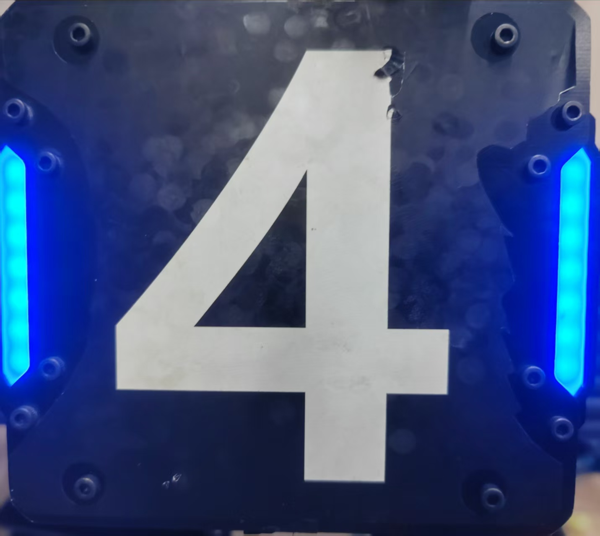
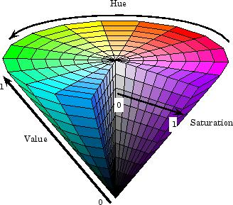
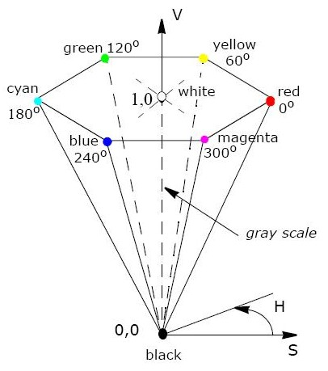
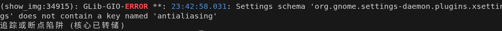

# RoboMaster视觉组第三次培训：装甲板的识别

## 目录

- [一、课程概述](#sec-overview)
- [二、OpenCV 函数的运用](#sec-opencv)
  - [1. 读图、缩放、显示](#sec-imread)
  - [2. 色彩空间与转换码](#sec-cvtcolor)
  - [3. 通道分离 `cv::split`](#sec-split)
  - [4. 轮廓 `cv::findContours` / `cv::drawContours`](#sec-contours)
  - [5. 旋转矩形 `cv::minAreaRect`](#sec-minarearect)
  - [6. 课堂作业 `show_img_hw` / `main_hw`](#sec-demo)
- [三、装甲板识别](#sec-detect)
  - [1. OpenCV在装甲板识别的用途](#sec-next)
  - [2. 整条流水线](#sec-detect-pipeline)
  - [3. 灰度 → 二值 → 轮廓 → 旋转矩形](#sec-detect-front)
  - [4. 几何过滤](#sec-detect-geom)
  - [5. 灯条配对](#sec-detect-pair)
  - [6. 数字分类](#sec-detect-digit)
  - [7. 课堂作业 `detect_armor_hw`](#sec-detect-hw)
- [四、用 `solvePnP` 求距离](#sec-pnp)
  - [1. 识别之后还缺什么](#sec-pnp-why)
  - [2. 投影方程：四个点如何定住一块板](#sec-pnp-math)
  - [3. \(R\) 和 \(t\) 是什么](#sec-pnp-rt)
  - [4. `cv::solvePnP` 怎么调用](#sec-pnp-api)
  - [5. 3D 模型点（必须和 2D 四点顺序一致）](#sec-pnp-3d)
  - [6. 课后作业 Task 01～03](#sec-pnp-hw)

<a id="sec-overview"></a>
## 一、课程概述

对视觉组来说，自瞄、打前哨站、打基地，都建立在「先把装甲板从图像里找出来」之上。能否快速识别装甲板，能否对装甲板的识别结果进行精确的打击，是考验所在，亦是职责所在。

## 

```
 imread
   │
   ├─ split 拆 B/G/R，看三个通道
   │
   └─ main：BGR → 灰度 → 二值 → 轮廓 → 旋转矩形
```

> [!note] 说明 | 像素和三原色
> &emsp;&emsp;如果把屏幕放大到微观层面，你会发现屏幕上显示的任何一张图片、一段文字，其实都不是一个连续的整体，而是由数百万个微小的“发光点”拼凑而成的，这些点就是像素。
> &emsp;&emsp;一个像素本身并不能发出五颜六色的光。我们之所以能看到万千色彩，是因为每个像素内部都包含了三个更小的发光单元，这就是子像素。
> &emsp;&emsp;这三个子像素分别发出光的三原色：红（Red）、绿（Green）和蓝（Blue）。通过控制这三个子像素各自发光的强弱（亮度），它们的光混合在一起，就能在人眼中呈现出任何你想要的颜色。

| 作业（`lecture3/`） | 说明 |
|--------------------------|------|
| `show_img_hw.cpp` / `main_hw.cpp` | 通道分离、灰度到旋转矩形 |
| `detect_armor_hw.cpp` | 几何过滤和灯条配对 |
| `pnp_hw.cpp` | 求解距离 |
| `include/detector.hpp` | 识别阈值、`get_color`、画结果 |
| `include/armor.hpp` | 灯条 / 装甲板的几何定义 |
| `include/img_tools.hpp` | 画点、画轮廓的小工具 |
| `imgs/red_2.jpg` | 红方装甲板 |
| `imgs/blue_4.jpg` | 蓝方装甲板 |


在 `lecture3/` 里编译作业，必须先进入这个目录：

```bash
cd lecture3
cmake -B build
make -C build
build/show_img_hw
build/main_hw
build/detect_armor_hw
build/pnp_hw
```

第一次编译要先 `cmake -B build`。之后改了代码，在 `lecture3/` 下 `make -C build` 再运行即可。


---

<a id="sec-opencv"></a>
## 二、OpenCV 函数的运用

<a id="sec-imread"></a>

### 导入
[OpenCV官网](https://opencv.org/)
安装 OpenCV：`sudo apt install libopencv-dev`。
查看版本 OpenCV：`apt show libopencv-dev`。


之后我们如果在程序中想要使用OpenCV，就可以直接写头文件：

```cpp
#include <opencv2/opencv.hpp>
```

### 1. 读图、缩放、显示

```cpp
cv::Mat img = cv::imread("imgs/red_3.jpg");   // 读出来是 BGR
cv::resize(img, img, {}, 0.5, 0.5);           // 宽高都变成 0.5 倍；{} 表示不指定绝对尺寸
cv::resize(img, img, cv::Size(   ,   ));      // 指定大小，先宽后高
cv::imshow("gray", img);                      // 窗口名自己起
cv::waitKey(0);                               // 等到按任意键再结束
```
> [!note] 说明 | 图像存储方式
> &emsp;&emsp; 正如刚刚所说，图片是由一个个像素点构成的，且通常会有宽度方向以及高度方向的像素。所有的像素进行排列之后便形成了一个矩阵，而opencv的Mat类型正好能起到对矩阵的存储作用。


<a id="sec-cvtcolor"></a>

### 2. 色彩空间与转换码


| 空间 | 通道 | 本课用途 |
|------|------|----------|
| **BGR** | B、G、R | `imread` 读取后的默认通道 |
| **Gray** | 单通道亮度 | 二值化、找轮廓的前置步骤 |
| **Binary** | 0 / 255 | `findContours` 的输入 |
| **HSV** | H（色相）、S（饱和度）、V（明度） | 按颜色分割（后续识别红/蓝会用） |

颜色转换：

```cpp
cv::cvtColor(src, dst, code);   // src：输入图；dst：输出图
```

OpenCV 里很多函数都这样写：`src` 是原来的图（source），`dst` 是处理完得到的新图（destination）。写代码时换成自己的变量名即可，例如 `cvtColor(bgr_img, gray_img, ...)`。

| 转换码 | 含义 |
|--------|------|
| `cv::COLOR_BGR2GRAY` | 彩色 → 灰度 |
| `cv::COLOR_BGR2HSV` | 彩色 → HSV |
| `cv::COLOR_BGR2RGB` | BGR → RGB（一般显示才用） |

灰度再变成二值：

```cpp
cv::threshold(src, dst, thresh, maxval, type);   // src：灰度图；dst：二值图
```

| 参数 | 本课取值 | 含义 |
|------|----------|------|
| `thresh` | `130` | 阈值 |
| `maxval` | `255` | 超过阈值时写成这个值 |
| `type` | `cv::THRESH_BINARY` | ≥ 阈值 → `maxval`，否则 → 0 |

合在一起：

```cpp
cv::cvtColor(bgr, gray, cv::COLOR_BGR2GRAY);
cv::threshold(gray, binary, 130, 255, cv::THRESH_BINARY);
```

后续按颜色抠灯条时会用到 HSV（HSV在此节中不做详细的讲解，在下面两张图中，带大家大致了解一下HSV大概是一个什么东西）：

```cpp
cv::cvtColor(bgr, hsv, cv::COLOR_BGR2HSV);
cv::inRange(hsv, cv::Scalar(100, 80, 80), cv::Scalar(124, 255, 255), mask);
```

`inRange` 的意思是：像素的 H、S、V 都落在上下限之间，就写成 255（白），否则写成 0（黑），结果放进 `mask`。

| 参数 | 本课取值 | 含义 |
|------|----------|------|
| 第 1 个 | `hsv` | 输入图（HSV） |
| 第 2 个 | `Scalar(100, 80, 80)` | 下限：H≥100，S≥80，V≥80 |
| 第 3 个 | `Scalar(124, 255, 255)` | 上限：H≤124，S≤255，V≤255 |
| 第 4 个 | `mask` | 输出的黑白掩码图 |

OpenCV 里 H 的范围是 **0～180**（不是 0～360）。上面这组大约是蓝色；红色会绕过 0 和 180，通常要写两段再拼起来。

###                

<a id="sec-split"></a>
### 3. 通道分离 `cv::split`

```cpp
std::vector<cv::Mat> channels;
cv::split(bgr_img, channels);     // 拆成 3 张单通道图
cv::Mat blue  = channels.at(0);   // B
cv::Mat green = channels.at(1);   // G
cv::Mat red   = channels.at(2);   // R
```

> [!note] 说明 | 通道
> &emsp;&emsp;通道是同一张图上的一层数值。彩色图里每个像素不只存一个亮度，而是把红、绿、蓝各存一个数，这三层就是 B、G、R 三个通道。
> &emsp;&emsp; 红方灯条在 **R 通道**往往数值更高，从而更明显，蓝方则在 **B 通道**数值更高，从而更明显。

<a id="sec-contours"></a>
### 4. 轮廓 `cv::findContours` / `cv::drawContours`

```cpp
cv::findContours(image, contours, mode, method);
```

| 参数 | 取值 | 含义 |
|------|----------|------|
| `image` | 二值图 `binary_img` | 白区域会被描边（代码形象演示） |
| `contours` | `std::vector<std::vector<cv::Point>>` | 外层：有几条轮廓；内层：这条轮廓上的点 |
| `mode` | `cv::RETR_EXTERNAL` | 只取最外层轮廓 |
| `method` | `cv::CHAIN_APPROX_NONE` | 保留边界上每一个点 |

画轮廓：

```cpp
cv::drawContours(image, contours, contourIdx, color, thickness);
```

| 参数 | 本课取值 | 含义 |
|------|----------|------|
| `contourIdx` | `{}` 或 `-1` | 画全部轮廓 |
| `color` | `{0, 0, 255}` | BGR 颜色，亮红 |
| `thickness` | `5` | 线宽 |

本课 `tools::drawContour` 会把轮廓上每个点画出来，方便看 `findContours` 到底找到了什么。

<a id="sec-minarearect"></a>
### 5. 旋转矩形 `cv::minAreaRect`

在找到轮廓后还不够，因为有的轮廓大，有的轮廓小，有的轮廓会包住另一个轮廓，这样画面就会非常乱，所以我们需要找到最小的旋转矩形来解决这一个问题。

```cpp
cv::RotatedRect rr = cv::minAreaRect(contour);   // 用面积最小的旋转矩形包住轮廓
std::vector<cv::Point2f> points(4);
rr.points(points.data());                        // 取出 4 个角点
```

轮廓数量事先不知道，用 `std::vector` 存：

```cpp
std::vector<cv::RotatedRect> rotated_rects;
rotated_rects.emplace_back(rotated_rect);   // 往末尾追加
```

画矩形四个角用 `tools::draw_points`。在副本上画图时先 `clone()`，避免把原图涂花：

```cpp
cv::Mat drawcontours = bgr_img.clone();
```

<a id="sec-demo"></a>
### 6. 课堂作业 `show_img_hw` / `main_hw`
#### tips:
## 

```bash
echo "$GSETTINGS_SCHEMA_DIR"
echo "$XDG_DATA_DIRS"
```
- > 看是不是会出现snap，如果出现了，建议重装换成官网的`.deb`安装包

```bash
unset GSETTINGS_SCHEMA_DIR
export XDG_DATA_DIRS=/usr/local/share:/usr/share
```

`class_3/` 里的完整效果：

```bash
cd class_3
build/show_img    # 应弹出 blue / green / red
build/main        # 应弹出 gray / binary / drawcontours / drawrect
```

你在 `lecture3/` 里填写并运行：

```bash
cd lecture3
make -C build show_img_hw main_hw
build/show_img_hw
build/main_hw
```

`show_img_hw.cpp` 要写：`imread`、`split`、取 B/G/R、`resize`、`imshow`。

`main_hw.cpp` 要写：

| Task | 函数 | 窗口 |
|------|------|------|
| 1 | `cvtColor`，转换码 `COLOR_BGR2GRAY` | `gray` |
| 2 | `threshold`，`130 / 255 / THRESH_BINARY` | `binary` |
| 3 | `findContours`，`RETR_EXTERNAL` + `CHAIN_APPROX_NONE` | （不弹窗） |
| 4 | `drawContours`，颜色 `{0, 0, 255}`，线宽 5 | `drawcontours` |
| 5 | `minAreaRect` + `emplace_back` | （不弹窗） |
| 6 | `rotated_rect.points(...)` | `drawrect` |

灰度、二值显示完后记得 `resize(..., 2, 2)` 恢复原大小，否则后面找轮廓会和原图对不上。

> 把路径改成 `imgs/blue_4.jpg`，看 blue / red 谁更亮。把阈值 `130` 改成 `80` 和 `200`，看 `binary` 和轮廓数量怎么变。

<a id="sec-detect"></a>
## 三、装甲板识别

<a id="sec-next"></a>
### 1. OpenCV在装甲板识别的用途

| 本课函数 | 后续用途 |
|----------|------------|
| `split` | 比较轮廓上蓝、红通道，判断敌我颜色 |
| `cvtColor` | 灯条检测前先转灰度 |
| `threshold` | 把亮灯条变成白色连通域 |
| `findContours` | 抠出灯条轮廓 |
| `minAreaRect` | 拟合灯条，再算长宽比、角度 |

以上是借助 OpenCV 对图像进行初步处理，而完整自瞄还会做几何过滤、灯条配对、数字分类等，即要回答：哪些矩形是灯条、哪两根构成一块板、板上写的是几。

<a id="sec-detect-pipeline"></a>
### 2. 整条流水线


```
BGR 原图
  │
  ├─ gray          灰度图
  │     │
  │     └─ binary  二值图（灯条变成白色连通域）
  │           │
  │           └─ contours / drawcontours  轮廓
  │                 │
  │                 └─ drawrect  旋转矩形（全部候选）
  │                       │
  │                       ├─ 【几何过滤】形状 + B/R 比色     → 灯条
  │                       │
  │                       ├─ 【灯条配对】同色两两配 + 再过滤 + 去重 → 装甲板候选
  │                       │
  │                       └─ 【数字分类】透视变换抠数字 + 网络     → 兵种 / 丢掉假板
  │
  └─ detection     在原图上画出灯条（红/蓝）和装甲板（绿框）
```

| 窗口  | 你在看什么 | 对应函数 |
|-----------|------------|----------|
| 原图 BGR | `imread` 读进来的彩色图 | — |
| `gray` | 亮度，灯条最亮 | `cvtColor` |
| `binary` | 亮的变成白、暗的变成黑 | `threshold` |
| `drawcontours` | 白色区域的边界 | `findContours` |
| `drawrect` | 用最小旋转矩形包住每条轮廓 | `minAreaRect` |
| `detection` | 滤完、配完之后的灯条和装甲板 | `detect_armor` |

<a id="sec-detect-front"></a>
### 3. 灰度 → 二值 → 轮廓 → 旋转矩形

刚刚我们了解到了**灰度 → 二值 → 轮廓 → 旋转矩形**的过程，那么进行几何过滤、灯条配对、数字分类具体要用到哪些参数呢？

```cpp
cv::cvtColor(bgr_img, gray_img, cv::COLOR_BGR2GRAY);
cv::threshold(gray_img, binary_img, 130, 255, cv::THRESH_BINARY);
cv::findContours(binary_img, contours, cv::RETR_EXTERNAL, cv::CHAIN_APPROX_NONE);
Lightbar lightbar(cv::minAreaRect(contour), id);
```

| 量 | 怎么来的 | 后面谁用 |
|----|----------|----------|
| `length` | `top` 到 `bottom` | 几何过滤（太短就扔） |
| `width` | 上端两个角的距离 | 算长宽比 |
| `ratio` | `length / width` | 几何过滤（不像细条就扔） |
| `angle` / `angle_error` | 相对竖直偏了多少 | 几何过滤；配对时还要看是否和底板垂直 |
| `{top, bottom}` | 灯条两端 | 配对时拼出装甲板四角 |

<a id="sec-detect-geom"></a>
### 4. 几何过滤

几何过滤要做的事只有一句：**单看这一根，它长得像不像灯条。**

判断用的阈值写在 `include/detector.hpp` 里。不用自己再定义：

```cpp
// include/detector.hpp
constexpr double kThreshold = 130;              // 课堂图实测；工程里常见 150
constexpr double kMaxAngleErrorDeg = 45;        // 灯条相对竖直的最大偏角
constexpr double kMinLightbarRatio = 1.5;       // 灯条长 / 宽
constexpr double kMaxLightbarRatio = 20;
constexpr double kMinLightbarLength = 15;       // 像素
constexpr double kMinArmorRatio = 1;            // 灯条间距 / 较长灯条
constexpr double kMaxArmorRatio = 5;
constexpr double kMaxSideRatio = 1.5;           // 两灯条长度比
constexpr double kMaxRectangularErrorDeg = 25;  // 两灯条与连线是否接近垂直
```

所用的**判断条件**如下：

| 二值图上长什么样 | 为什么不是灯条 | 哪条规则挡掉 |
|------------------|----------------|--------------|
| 横着的一条亮带 | 灯条应当接近竖直 | 偏角 ≥ 45° |
| 只有几个像素的小亮点 | 太远或只是噪声 | 长度 ≤ 15 像素 |
| 接近正方形的亮块 | 多半是数字、反光 | 长宽比不在 1.5～20 |

三项**同时**成立才留下，否则就 `continue`。

```cpp
if (!check_lightbar(lightbar)) continue;
```

在**代码**里具体对应关系如下：

| 条件 | 阈值 | 为什么这样设 | 挡掉什么 |
|------|------|--------------|----------|
| 偏角 `< 45°` | `kMaxAngleErrorDeg` | 车上的灯条接近竖直；车侧倾、斜着看时会歪一点，但很少超过 45° | 地平线、横灯带 |
| 长宽比 `1.5～20` | `kMin/MaxLightbarRatio` | 灯条是细长矩形。接近正方形（比值 ~1）不是灯条；细得像一条线（>20）多半是噪点 | 数字块、极细的亮线 |
| 长度 `> 15` 像素 | `kMinLightbarLength` | 太短的亮点打不准，也容易是噪声 | 碎反光 |

**形状过了，再用颜色挡一次：** 正如刚刚所介绍的通道，我们将各个通道的数值相加，在进行大小比较，就能判断颜色了。

```cpp
blue_sum += bgr_img.at<cv::Vec3b>(point)[0];   // B
red_sum  += bgr_img.at<cv::Vec3b>(point)[2];   // R

if (red_sum  > blue_sum * 1.2) color = red;
if (blue_sum > red_sum  * 1.2) color = blue;
```

> [!warning] `1.2` 是为了别把「差不多亮」误判成红或蓝。

过完这一步，列表里剩下的才叫灯条：有形状、有红/蓝。

<a id="sec-detect-pair"></a>
### 5. 灯条配对

一块装甲板不是一根灯条，而是左右两根**同色**灯条夹着一块数字板：

```
  左上 ●————————● 右上
       |   3    |
       |        |
  左下 ●————————● 右下
```

配对要做的事：**从已经滤好的灯条里，找出「这两根属于同一块板」的组合。**

**`detector_armor.cpp`能够演示这种情况**。

**构造**时四个角取两根灯条的端点：**左上、右上、右下、左下**（顺序后面 PnP 还要用）。

**中心**是两根灯条中心的中点。然后用三个量判断「这两根像不像一块板」——这是配对之后的第二轮几何过滤，滤的是**一对灯条的相对关系**，不是单根。

**配对**是「所有同色灯条两两试」，不是只配相邻的。所以三根并排时会配出两块「装甲板」，中间那根被共享：

```
A —— B —— C      配出 (A,B) 和 (B,C)，B 用了两次
```

**去重**共享灯条时，留下 `ratio` 更接近 **2.5** 的那块（更像常见的小装甲）。

<a id="sec-detect-digit"></a>
### 6. 数字分类 （这节课做了解）

几何过滤和配对只看灯条形状。场上两根碰巧平行的灯、广告牌、误配的灯条，仍可能画出一个很像装甲板的绿框。自瞄还要知道**这是谁**：1 号英雄、2 号工程、3/4步兵、哨兵、前哨站、基地，或者根本不是板。

分类要做的事：**把两灯条中间那块图案抠成一张正视图，交给神经网络认数字。**

```
原图上的斜四边形                    固定大小的正视图
  ●——————●                            ┌────────┐
   \  3  /     warpPerspective        │   3    │  → 网络 → "3"（步兵，小装甲）
    ●——●                              └────────┘
```

四点顺序必须和配对时一致：`左上、右上、右下、左下`。透视变换把任意姿态的数字拉成同一尺寸，远近、倾斜造成的变形就先被消掉，网络才比较好认。

```cpp
// 原理示意，当前 detect_armor 还没有这一步
std::vector<cv::Point2f> src = armor.points;
std::vector<cv::Point2f> dst = {{0, 0}, {W - 1, 0}, {W - 1, H - 1}, {0, H - 1}};
cv::Mat M = cv::getPerspectiveTransform(src, dst);
cv::warpPerspective(gray_img, pattern, M, {W, H});
// pattern 送进分类网络
```


<a id="sec-detect-hw"></a>
### 7. 课堂任务 `detect_armor_hw`

在 `lecture3/detect_armor_hw.cpp` 里按 Task 把几何过滤和灯条配对填上。灰度 → 二值 → 轮廓已经写好，`get_color`、去重、画图也已经给好。阈值就是上面 `include/detector.hpp` 里那几行（`kMaxAngleErrorDeg` 等），作业已经 include 了这个头文件，直接写这些名字。

```bash
cd lecture3
make -C build detect_armor_hw
build/detect_armor_hw
build/detect_armor_hw imgs/red_2.jpg
```

| Task | 做什么 | 填在哪 |
|------|--------|--------|
| 1 | 写出灯条的 `angle_ok` / `ratio_ok` / `length_ok` | 几何过滤循环里 |
| 2 | 三项不都成立则 `continue` | Task1 后面 |
| 3 | `get_color(...)` 失败则 `continue` | Task2 后面 |
| 4 | 两根灯条不同色则 `continue` | 配对的双层循环里 |
| 5 | 用第 `i`、`j` 根灯条构造 `Armor armor` | Task4 后面 |
| 6 | 写出装甲板的 `ratio_ok` / `side_ok` / `rect_ok`，都过了才 `emplace_back` | Task5 后面 |

只填完 Task1～3：终端里「灯条」应大于 0，`detection` 上有红/蓝灯条，还没有绿框。六题都填完：应弹出 `binary` / `detection`，绿框套住装甲板，效果和 `class_3/` 里的 `build/detect_armor` 一致。

`kMaxAngleErrorDeg`、`kMaxRectangularErrorDeg` 单位是**度**，`lightbar.angle_error` 和 `armor.rectangular_error` 是**弧度**，比较时要乘 `CV_PI / 180.0`。

> 只填几何、不填颜色，红图往往还能配上（默认色是红），蓝图会配错。把 `kMinLightbarLength` 改成 `80`，看远处细灯条会不会被滤掉。

识别到这里，已经有颜色、中心和四个角点。下一步用 `solvePnP` 把这四个像素点变成空间里的距离和朝向，见第四节。

<a id="sec-pnp"></a>
## 四、用 `solvePnP` 求距离

自瞄要打的不是「图像里的绿框」，而是几米外那块真实装甲板。这时候，就需要借助**PnP**的力量了。简单来说，**PnP** 是已知 \(n\) 个点的 3D 坐标和它们在图像上的 2D 投影，反推相机的位姿。装甲板刚好有 4 个角点，所以 \(n = 4\)。
> [!warning] tips
> 由于PnP的原理十分复杂，在课后作业里面，我们只需了解是如何调用的就行。

```
detect_armor → 左上 / 右上 / 右下 / 左下 四个角点 + 板型
        │
        ▼
object_points（3D 真实尺寸）+ img_points（像素）+ 内参
        │
        ▼
cv::solvePnP(...)  →  rvec, tvec
        │
        ▼
距离 ≈ ||tvec|| ，朝向从 rvec 里拆
```

> [!warning] tips
> 以下的1~3在上节课相机标定时已经有所了解，所以我们接下来直接进入solvePnP的讲解，如果有相机标定原理不懂的，课后可以在课件里面自行复习巩固。

<a id="sec-pnp-why"></a>
### 1. 识别之后还缺什么

相机标定得到的内参矩阵 \(K\) 只能告诉你：这个像素对应空间里的**一条射线**。同一条射线上，1 米处的小装甲板和 10 米处的大装甲板会投到同一个像素——有方向，没有距离。

PnP 需要三样东西一起用：

| 输入 | 从哪来 | 本课对应 |
|------|--------|----------|
| 相机内参 \(K\)、畸变 | 标定 |  `pnp_hw.cpp` 里已经准备好 |
| 装甲板真实 3D 尺寸 | 规则手册 | 小装甲宽 13.5 cm，大装甲宽 23 cm，灯条长 5.6 cm |
| 图像上的 4 个 2D 点 | 识别 | `armor.left.top`、`right.top`、`right.bottom`、`left.bottom` |

没有真实尺寸，四个像素点可以对应任意远近的板；没有内参，像素和毫米对不上。三样缺一，距离都解不准。

<a id="sec-pnp-math"></a>
### 2. 投影方程：四个点如何定住一块板

把装甲板上的一个 3D 点写成 \(P^w = (X, Y, Z)\)，它投到图像上是像素 \(p = (u, v)\)。针孔相机满足：

\[
s \begin{bmatrix} u \\ v \\ 1 \end{bmatrix}
= K \, [R \mid t] \, \begin{bmatrix} X \\ Y \\ Z \\ 1 \end{bmatrix}
\]

拆开看两步：

1. \([R \mid t]\)：先把点从**装甲板坐标系**变到**相机坐标系**（转一下、再平移）
2. \(K\)：再把相机坐标变成像素。\(s\) 是一个比例因子（深度），每个点都可以不同

PnP 的已知是 \(K\)、\(P^w\)、\((u,v)\)，未知是 \(R\) 和 \(t\)。每个点对提供两个约束（\(u\) 和 \(v\)）。旋转 3 个数、平移 3 个数，一共 6 个未知数，所以理论上 **\(n \geq 3\)** 就能解。装甲板有 4 个角点，约束比未知数多，属于超定问题，噪声下更稳。

内参 \(K\) 长这样（9 个数按行排成 \(3\times3\)）：

\[
K = \begin{bmatrix} f_x & 0 & c_x \\ 0 & f_y & c_y \\ 0 & 0 & 1 \end{bmatrix}
\]

| 量 | 含义 |
|----|------|
| \(f_x, f_y\) | 焦距，单位是像素 |
| \(c_x, c_y\) | 主点，一般在图像中心附近 |

\(f_x\) 标大了，同样大的板会被当成「更远」；课堂把 `fx` 改大，算出来的距离也会变大。畸变系数把镜头的桶形/枕形变形补掉，近距离、画面边缘时更明显。

<a id="sec-pnp-rt"></a>
### 3. \(R\) 和 \(t\) 是什么

同一个点在装甲板坐标系和相机坐标系里数字不同。PnP 求出的就是「物体 → 相机」：

\[
P^c = R \cdot P^w + t
\]

- \(t = (t_x, t_y, t_z)^\top\)：装甲板原点（板中心）在相机坐标系里的位置。相机朝前一般是 \(+Z\)，所以 \(t_z\) 大约就是「有多远」。完整距离 \(d = \|t\| = \sqrt{t_x^2 + t_y^2 + t_z^2}\)，代码里 `cv::norm(tvec)`
- \(R\)：\(3\times3\) 旋转矩阵，描述板相对相机转了多少。`solvePnP` 先输出的是旋转向量 `rvec`（轴的方向 × 转过的角度），要用 `cv::Rodrigues(rvec, R)` 变成矩阵，再拆成 yaw / pitch / roll

合在一起是 6 自由度位姿：3 个平移 + 3 个旋转，自瞄打的就是这个。


平面物体用 `SOLVEPNP_IPPE` 时，数学上可能出现**两组解**（板的正反两面都能投出相近的四个点）。正对着时 yaw 也不敏感：四个角点左右动一点点，算出来的左右转角会跳。工程里会再筛「背对相机」的解，并用重投影误差微调 yaw——那是后话。本课先保证 \(R,t\) 能求出来。


<a id="sec-pnp-api"></a>
### 4. `cv::solvePnP` 怎么调用

```cpp
bool cv::solvePnP(
    objectPoints,   // 3D 模型点（物体坐标系，单位米）
    imagePoints,    // 对应的 2D 像素点
    cameraMatrix,   // 内参 K
    distCoeffs,     // 畸变系数
    rvec,           // 输出：旋转向量（3×1）
    tvec);          // 输出：平移向量（3×1）
         
```

| 参数 | 本课怎么填 | 含义 |
|------|------------|------|
| `objectPoints` | 装甲板 4 个 3D 点 | 以装甲板中心为原点，单位**米** |
| `imagePoints` | 四个灯条端点的像素坐标 | 顺序必须和 3D 点一一对应 |
| `cameraMatrix` | \(3\times3\) 的 \(K\) | `[fx, 0, cx; 0, fy, cy; 0, 0, 1]` |
| `distCoeffs` | 一般 5 个数 | 标定得到的畸变 |
| `rvec` | 输出 | **旋转向量**，不是旋转矩阵 |
| `tvec` | 输出 | 平移，相机坐标系，单位米 |


<a id="sec-pnp-3d"></a>
### 5. 3D 模型点（必须和 2D 四点顺序一致）

四个角点在「装甲板中心为原点」的物体坐标系里取值，单位米：**装甲板就在 \(XY\) 平面上（\(Z = 0\)）**。

```
        X →  （右为正）
   左上              右上
  (-W/2, -L/2)    (+W/2, -L/2)
Y ↓
   左下              右下
  (-W/2, +L/2)    (+W/2, +L/2)
```

- `ARMOR_WIDTH`：两灯条间距。
- `LIGHTBAR_LENGTH`：灯条长度
- 顶部 \(Y\) 为负、底部 \(Y\) 为正，和「从上到下」一致
- 本课 `Armor` 构造时四个角就是 `left.top`、`right.top`、`right.bottom`、`left.bottom`，和上面四点一一对应。

<a id="sec-pnp-hw"></a>
### 6. 课后作业 Task 01～03

内参 `camera_matrix`、`dist_coeffs` 和识别得到的 `armor` 已经写在 `lecture3/pnp_hw.cpp` 里。按 Task 填三处：3D 点、像素点、调用 `solvePnP`。

| Task | 填什么 | 注意 |
|------|--------|------|
| 01 | `object_points` 四个 3D 点 | 单位米；左上 → 右上 → 右下 → 左下 |
| 02 | `img_points` 四个像素点 | 用 `armor` 上对应的灯条端点，顺序和 Task 01 一致 |
| 03 | `cv::solvePnP(...)` 的参数 | 3D 点、像素点、内参、畸变、`rvec`、`tvec` |

```cpp
// #### Task 01 ################################################
// 填写 object_points（物体坐标系，装甲板中心为原点，Z = 0）
static const std::vector<cv::Point3f> object_points{
    {                ,                     , 0}, 
    {                ,                     , 0}, 
    {                ,                     , 0}, 
    {                ,                     , 0}
};

// #### Task 02 ################################################
// img_points 是照片上装甲板 4 个点的像素坐标
std::vector<cv::Point2f> img_points{
    // 与 Task 01 同一顺序
    // 例如：armor.left.top,

};

// #### Task 03 ################################################
cv::Mat rvec, tvec;
// 调用 solvePnP，rvec / tvec 用来存输出
cv::solvePnP( /* 在这里填写参数 */ );
```

没填完时终端会提示还没调用 `solvePnP`。三题都填完，效果应为：终端打印距离、`tvec`、`rvec`、yaw/pitch/roll，窗口 `pnp` 里画坐标轴。
