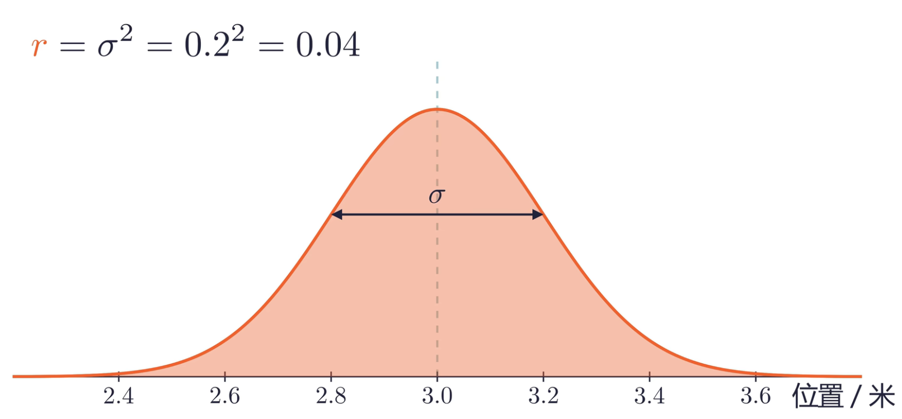

# Lecture 5: Hello Kalman

[TOC]

> tips: 本次课程内容前面部分没有什么展示内容，更多是计算，可能会有点枯燥。

---

## 一、卡尔曼滤波简介
### (1) 为什么需要卡尔曼滤波？
子弹飞行需要时间，想要击打正在运动的装甲板，我们需要**预测**装甲板的位置。但是：
- **运动无法建模**：装甲板的运动方式难以预见，它可能是自转、变速移动、甚至二者的结合。
- **观测存在误差**：相机拍摄的画面清晰度可能不足，模型识别的结果有误差，PnP解算的结果也不是完全准确的。

一个朴素的办法是最小二乘估计，可以简单理解为取平均值。但是这有一个致命的缺陷：当敌方状态发生变化的时候，我们之前的统计数据马上就变得不可靠了，需要再收集一定时间的数据才能跟上敌方状态的变换。这种滞后是不可接受的。

为了能够相对准确且较快地预测目标的位置，我们使用了卡尔曼滤波算法。它融合 **之前观测数据得出的预测值** 和 **当前看到的观测值**，计算出一个相对靠谱的估计位置。

### (2) 卡尔曼滤波思想由来
&emsp;&emsp;假设现在我们需要量一支笔的长度。由于每次在尺子上读数都会有一点误差，为了尽可能精确地测量出笔的真实长度，我们很容易就会想到可以**多次测量取平均值**。
&emsp;&emsp;我们设 $z_k$ 表示第 $k$ 次测量的结果，$\hat{x_k}$ 表示第 $k$ 次测量时我们对长度的估计值，那么显然：
$$\hat{x_k} = \frac{1}{k}(z_1+z_2+\cdots+z_{k-1}+z_k)$$

对于这个式子，我们可以进行一些推导：
$$
\begin{aligned}
    \hat{x_k} &= \frac{k-1}{k}\cdot\frac{1}{k-1}(z_1+\cdots+z_{k-1})+\frac{1}{k}z_k \\[10pt]
    \hat{x_k} &= \frac{k-1}{k}\hat{x_{k-1}}+\frac{1}{k}z_k \\[10pt]
    \hat{x_k} &= \hat{x_{k-1}}+\frac{1}{k}(z_k-\hat{x_{k-1}})
\end{aligned}
$$

这个公式告诉了我们：
$$\text{新的估计值}=\text{上一次的估计值}+\text{一个系数}\times(\text{当前测量值}-\text{上一次的估计值})$$

&emsp;&emsp;我们可以发现，当系数为 $0$ 时，我们直接忽略了当前测量值而相信上一次的预测；当系数为 $1$ 时，我们忽略了上一次的预测而相信了测量值。也就是说，调整这个系数就可以调整我们对**上次估计值**和**当前测量值**的**信任度分配**。这个系数在算法中称为<b>卡尔曼增益（Kalman Gain，记为 K）</b>。而卡尔曼滤波器则是通过数学的方式动态调整这个增益以获取理论上最有可能的预测。

---
## 二、卡尔曼滤波前置知识
### (1) 数据融合
> 以下内容来自 DR_CAN 关于卡尔曼滤波的讲解，其视频链接已经放在参考资料部分。

假设我们需要称量出一个物体的质量，我们目前有来自两个不同精准度的秤的数据。每个秤获取的质量并不是准确值，准确值在其周围出现的可能性呈现**正态分布**（以下的 $\sigma$ 是标准差）：
$$
z_1 = 30\,\text{g}，\sigma_1 = 2\,\text{g} \\ 
z_2 = 32\,\text{g}，\sigma_2 = 4\,\text{g} \\ 
$$

接下来我们需要用这两个值计算一个最可能的真实值。那么什么是最可能呢？我们算出的值其实也不是真实值，也是一个估计值且带有方差。若它最接近真实值，那么它的**方差应当最小**。

我们可以利用卡尔曼滤波的思想，设估计值 $\hat{z} = z_1 + k (z_2 - z_1)$，那么我们就要计算一个 $k$ 使得 $\hat{z}$ 的方差最小。
$$
\begin{aligned}
\sigma_{\hat{z}}^2 &= \text{var} (z_1 + k(z_2 - z_1)) \\ &= \text{var}((1-k)z_1 + kz_2) \\
&= \text{var}((1-k)z_1) + \text{var}(kz_2)  \\ &= (1-k)^2 \text{var}(z_1) + k^2 \text{var}(z_2)\\ &= (1-k)^2\sigma_1^2 + k^2\sigma_2^2
\end{aligned}
$$

之后求导算出最合适的 $k$ 为：$$k = \frac{\sigma_1^2}{\sigma_1^2 + \sigma_2^2} = 0.2$$

于是可以推算出 $$\hat{z} = z_1 + k (z_2 - z_1)=30.4\,\text{g}，\sigma_{\hat{z}}^2 = (1-k)^2\sigma_1^2 + k^2\sigma_2^2 = 3.2$$

这样我们就得到了最可能的质量与其方差，而如果我们又获取了新的数据，我们还可以再结合这两个数据得到新的估计值。

### (2) 状态空间表达
> 状态空间表达有一个完整的体系，这是现代控制理论的基础。有兴趣的同学可以去看 [DR_CAN的现代控制理论](https://www.bilibili.com/video/BV1yx411u7iX)。这里只对离散形式的状态空间表达做简单的介绍。

&emsp;&emsp;不论是观测还是控制，我们的**机器不能做到连续平滑的控制**。比如说我们在赛场上要控制机器人时，发送指令是有间隔的，那么在这个间隔之间，电机保持输出指定的力，直到下一次发送指令后才发生变化。因此，我们只会分析机器人**在一定时间间隔处（我们称为采样时间）的状态**。

&emsp;&emsp;一个质量为 $m$ 物体在光滑水平面，它在初始时的位置为 $x_0$，速度为 $v_0$。在之后的一段时间 $t$ 之内，我们给它施加一个水平恒力 $F_0$，那么容易得到这个时间之后它的速度和位置：
$$
\begin{aligned}
    v_1 &= v_0 + \frac{F_0}{m}t \\ 
    x_1 &= x_0 + v_0t+ \frac{F_0}{2m}t^2
\end{aligned}
$$

使用矩阵来表示这两条等式：

$$
\begin{bmatrix} x_1 \\ v_1 \end{bmatrix} = \begin{bmatrix} 1&t \\ 0&1 \end{bmatrix}\begin{bmatrix} x_0 \\ v_0 \end{bmatrix} + \begin{bmatrix} \frac{t^2}{2m} \\[6pt] \frac{t}{m}\end{bmatrix}F_0
$$

我们把这个物体的位置和速度称为它的状态，记 $kt$ 时间后的状态为 $\mathbf{X_k}$，此时施加的力 $F_k$ 记为 $u_k$（也就是控制量）。得到：
$$
\mathbf{X_k} = \mathbf{AX_{k-1}} + \mathbf{B}u_{k-1}
$$

同时，假设我们可以观测到物体的位置和速度，记 $kt$ 时刻的观测结果为 $\mathbf{Z_k} = \begin{bmatrix} z_x \\ z_v \end{bmatrix}$，那么可以得到：
$$
\begin{bmatrix} z_x \\ z_v \end{bmatrix} = \begin{bmatrix} 1&0 \\ 0&1 \end{bmatrix}\begin{bmatrix} x_k \\ v_k \end{bmatrix} \\[10pt]
\text{即}\,\mathbf{Z_k} = \mathbf{HX_k}
$$

这两条矩阵表达式就是**离散形式的状态空间表达式**，它：
- 将一个物体中的**部分属性**（如速度、位置等）记录为一个状态矩阵。
- 描述了这个状态**在采样时间后理论上的变化**。
- 描述了观测结果和状态之间的关系。

### (3) 协方差矩阵
方差想必大家都不陌生，其表示了**数据分散的程度**；协方差也是一个统计学上的概念，它需要两种不同的数据来计算，反应了**两个数据的相关程度**，即协方差越大越正相关。
$$\sigma_x\sigma_y = \frac{1}{n}\sum\limits_{i=1}^n(x_i-\overline{x})(y_i-\overline{y})$$

而协方差矩阵就是存储了协方差和方差的矩阵，它表示了**每个数据本身的不确定性**，以及**各个数据之间的相关性**。
$$ \mathbf{P} =
\begin{bmatrix}
\sigma_1^2&\sigma_1\sigma_2&\sigma_1\sigma_3\\
\sigma_2\sigma_1&\sigma_2^2&\sigma_2\sigma_3\\
\sigma_3\sigma_1&\sigma_3\sigma_2&\sigma_3^2
\end{bmatrix}
$$

---
## 三、卡尔曼滤波运算流程
### (0) 准备工作
我们需要知道：
- $\mathbf{x_0}$：系统预计的初始状态。
- $\mathbf{P_0}$：系统的初始误差协方差矩阵。这其实可以类比我们数据融合时的预测结果的方差，它表示了我们**对这次预测结果的不确定程度**。
- 状态空间方程的一些参数，这包含：
  - 过程预测方程：$\mathbf{x_k = Ax_{k-1} + \omega_k}$。其中 $\mathbf{\omega_k}$ 是过程噪声。我们需要知道 $\mathbf{A}$。
  - 测量值与状态的关系：$\mathbf{z_k = Hx_k + v_k}$。其中 $\mathbf{v_k}$ 是测量噪声。我们需要知道 $\mathbf{H}$。

以及一些新的东西，这个我们结合后面的流程讲：
- $\mathbf{Q}$：过程噪声矩阵，将会用于先验误差协方差矩阵的计算。
  - $\mathbf{Q}=E[\mathbf{\omega\omega^T}]$，这里的 $E$ 表示计算期望。
- $\mathbf{R}$：测量噪声矩阵，将会用于卡尔曼增益的计算。
    - $\mathbf{R}=E[\mathbf{vv^T}]$，这里的 $E$ 表示计算期望。

### (1) 先验
**1. 使用状态空间方程先估计下一个时刻的状态**
$$\mathbf{\hat{x}_k^- = A\hat{x}_{k-1}}$$

这里没有控制量 $u$，因为我们无法知道对方机器人受到了什么力，所以我们只能<b>假设这台机器人匀速移动和匀速旋转</b>。计算出的状态我们称为**先验状态**。

**2. 计算先验误差协方差矩阵**

$$\mathbf{P^-_k = AP_{k-1}A^T+Q}$$

由于我们的运动模型不可能完全精确（例如，机器人可能并非严格的匀速运动），经过一次模型推算后，我们对系统状态估计的不确定性会增加。
- **$P_k$​ (状态协方差矩阵)**：量化了我们对状态估计值的不确定程度。矩阵越大，表示不确定性越高。
- **$Q_k$​ (过程噪声协方差矩阵)**：它代表了预测模型本身与真实世界之间的误差。这个参数需要我们根据经验设定，用于补偿模型未考虑到的随机扰动（如地面摩擦变化、机器人突然变速等）。

### (2) 后验
根据一些复杂的推导（详细可见 DR_CAN 的系列视频，其实不是很难），我们利用公式计算卡尔曼增益：
$$
\mathbf{K_k = P^-_k \, H^T \,\, (HP^-_kH^T+R)^{-1}} \\[10pt]
\text{其实可以理解为：}\mathbf{K_k = \frac{P^-_k \, H^T}{HP^-_kH^T+R}}
$$
这里的 $\mathbf{R}$ 是**观测噪声协方差矩阵**，它量化了测量值的不确定程度。由于观测量之间通常不相关，这个矩阵是一个对角矩阵，其中的值越大表示某个观测量的不确定度越高。
然后结合卡尔曼增益算出最可能的状态：
$$\mathbf{\hat{x}_k = \hat{x}_k^- + K_k(z_k - H\hat{x}_k^-)}$$

### (3) 更新误差协方差矩阵
为了进行下一步的计算，我们需要更新误差协方差矩阵。这可以类比为算出这次结果的方差：
$$
\mathbf{P_k = (I-K_kH)P^-_k} \\[8pt]
\mathbf{P_k = (I-K_kH)P^-_k(I-K_kH)^T + K_kRK_k^T}
$$

> [!tip] 注释 | 为什么列两条等式
> 上面两条式子在数学中是**等价的**。但是由于计算机的浮点数精度有限，计算时可能会因为精度问题导致丢失一些小数而使得计算结果出现问题。因此程序中采用<b>第二条等式，它更加复杂但是更对称</b>，这样可以尽可能减少因为精度问题导致的计算错误。

---
## 四、扩展卡尔曼滤波器
一些系统（比如匀速运动的物体）可以使用线性的状态空间方程来描述它：
$$
\begin{aligned}
    \mathbf{x_k} &= \mathbf{Ax_{k-1} + Bu_{k-1} + \omega_k} \\ 
    \mathbf{z_k} &= \mathbf{Hx_k + v_k}
\end{aligned}
$$

但不是所用状态都可以使用线性的状态空间方程表示的，其计算中可能还包含更复杂的算式，这些系统应当写为：
$$
\begin{aligned}
    \mathbf{x_k} &= f(\mathbf{x_{k-1},u_{k-1},\omega_k}) \\ 
    \mathbf{z_k} &= h(\mathbf{x_k,v_k})
\end{aligned}
$$

那么这些系统就需要使用**泰勒展开做线性化近似**来使用。这个内容在高等数学中也有涉及，可以理解为使用当前位置的切线近似表示上面的状态空间方程。此时：
$$\mathbf{A} = \text{Jacobian Matrix of } f \\ \mathbf{H} = \text{Jacobian Matrix of } h$$

带入之前的方程中计算即可。

---
## 五、卡尔曼滤波器的不足
卡尔曼滤波默认目标是匀速平动和匀速转动的，会产生以下问题：
- 如果目标曲线运动且同时在自转，这时预测和测量值误差会相当大。
- 敌方机器人也可能不是匀速转动的哦...

此外：
- 我方机器人自身的运动会一定程度影响观测。
- 地面不平整、操作手进行微操等会产生大量扰动。

---
## 参考资料
> [!example] 参考资料
> 1. DR_CAN 的[卡尔曼滤波器数学原理推导](https://www.bilibili.com/video/BV12D4y1S7fU)。
> 2. 同济大学27培训 [自瞄第五讲【Kalman&&整车建模】](https://www.bilibili.com/video/BV1xVpz6jExo)。

---
> [!important]
> &emsp;&emsp;本次课程没有课后作业，请大家及时完成大作业和其他课程的课后作业！作业截至日期是10月27日，也就是本次课程后的一个星期。建议大家尽快交已经完成的作业，否则卡点提交会导致批改缓慢。
> &emsp;&emsp;如果觉得作业内容实在有难度，可以只提交一部分内容和你对于较难内容的尝试，并写一个文档说明一下情况（内容不做要求，可以包括你哪部分没做出来，是因为什么不会做等）。